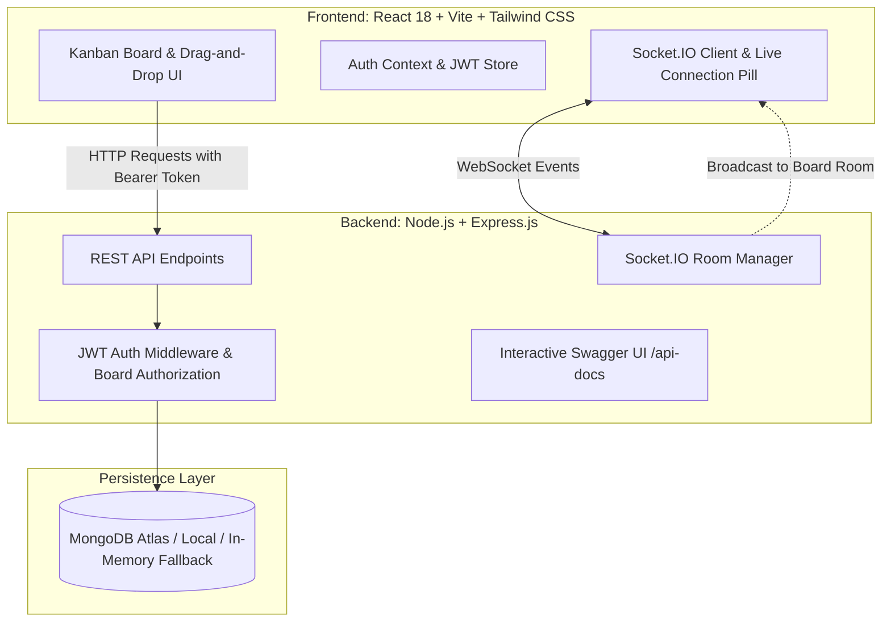

# ⚡ SyncBoard — Real-Time Collaborative Kanban Board
> **AImploy Technical Assessment Submission — Task 1: Full-Stack Developer**  
> *A production-grade, highly responsive task-management web application featuring room-based WebSocket synchronization, role-based authorization, optimistic drag-and-drop, and comprehensive test coverage.*

---

## 🚀 Live Demo & Documentation Links

| Resource | Live Production Link | Local Development Link |
| :--- | :--- | :--- |
| **Frontend Web App** | **[syncboard-client-xkpi.onrender.com](https://syncboard-client-xkpi.onrender.com)** | [http://localhost:5173](http://localhost:5173) |
| **Backend API Server** | **[syncboard-api-zawe.onrender.com](https://syncboard-api-zawe.onrender.com)** | [http://localhost:5000](http://localhost:5000) |
| **Interactive Swagger API Docs** | **[syncboard-api-zawe.onrender.com/api-docs](https://syncboard-api-zawe.onrender.com/api-docs)** | [http://localhost:5000/api-docs](http://localhost:5000/api-docs) |
| **Backend Health Check** | **[syncboard-api-zawe.onrender.com/health](https://syncboard-api-zawe.onrender.com/health)** | [http://localhost:5000/health](http://localhost:5000/health) |

> [!NOTE]
> *On the free tier, Render automatically spins down services after 15 minutes of inactivity. If visiting the live app for the first time in a while, please allow ~30 seconds for the backend instance to spin up.*

---

## 📋 Evaluation Checklist & Acceptance Criteria

| Requirement | Implementation Detail | Status |
| :--- | :--- | :---: |
| **Authentication & AuthZ** | JWT Bearer token authentication, bcrypt password hashing, board ownership & member-level route authorization (403 Forbidden for unauthorized users). | ✅ Complete |
| **User-Specific Boards & Cards** | Multi-board workspaces, task cards with `title`, `description`, `status` (`To Do`, `In Progress`, `Done`), `priority`, `assignee`, and timestamps. | ✅ Complete |
| **Interactive Movement** | Smooth drag-and-drop reordering via `@hello-pangea/dnd`, plus accessible direct status-toggle action badges on every card. | ✅ Complete |
| **Real-Time Collaboration** | Room-isolated WebSocket broadcasting using Socket.IO (`card:created`, `card:updated`, `card:moved`, `card:deleted`, `card:typing`, `active-users`). | ✅ Complete |
| **Zero-Refresh Synchronization** | Multiple concurrent browser sessions (e.g., normal window + incognito) viewing the same board sync instantly without refreshing. | ✅ Complete |
| **Persistence & Database Indexes** | MongoDB with compound indexes (`boardId`, `status`, `order`, `assignee`). Changes survive page reloads and server restarts. | ✅ Complete |
| **Connection & UI States** | Responsive UI with live connection status pill (`Connected (Live Sync)` / `Connecting...` / `Offline`), loading skeletons, and empty states. | ✅ Complete |
| **Zero-Config Reviewer Setup** | Seamless fallback to `mongodb-memory-server` if local MongoDB is not running, allowing 1-click execution without external dependencies. | ✅ Complete |
| **Automated Testing Suite** | Comprehensive Jest + Supertest integration test suite covering auth, duplicate prevention, unauthorized access rejection, and card movement. | ✅ Complete |

---

## 🏗️ Architecture & Data Flow



---

## 🛠️ Technology Stack

- **Frontend**: React 18, Vite, Tailwind CSS, `@hello-pangea/dnd` (accessible drag-and-drop), `socket.io-client`, Axios, Lucide Icons.
- **Backend**: Node.js (ES Modules), Express.js, Socket.IO.
- **Database & ODM**: MongoDB with Mongoose (with automated in-memory fallback for local development).
- **Authentication**: JSON Web Tokens (JWT), bcrypt.js.
- **API Documentation**: Swagger UI / OpenAPI 3.0 mounted at `/api-docs`.
- **Testing**: Jest, Supertest, MongoDB Memory Server.

---

## ⚡ Quickstart Guide (Local Development)

### Prerequisites
- Node.js `v18+` or `v20+` (Tested on Node `v22.20.0`)
- npm `v9+` or `v10+`
- *(Optional)* Local MongoDB or MongoDB Atlas URI (SyncBoard will automatically start an in-memory database if no local MongoDB is detected).

### 1. Clone & Install Dependencies
```bash
git clone <repository-url>
cd "AImploy assignment"

# Install both backend and frontend dependencies in one command:
npm run install:all
```

### 2. Environment Setup
The project comes pre-configured with default `.env` files for both server and client:
- `server/.env` (configured for port 5000 and JWT secret)
- `client/.env` (configured for port 5173 pointing to local server)

### 3. Start the Application
Open two terminal windows (or run concurrently):

**Terminal 1 — Backend Server:**
```bash
cd server
npm run dev
# Or from the root directory:
npm run server
```
*Server starts on `http://localhost:5000` with interactive Swagger docs at `http://localhost:5000/api-docs`.*

**Terminal 2 — Frontend Client:**
```bash
cd client
npm run dev
# Or from the root directory:
npm run client
```
*Client starts on `http://localhost:5173`.*

---

## 👥 Testing Real-Time Multi-User Collaboration

To experience the dual-session real-time sync with zero effort:
1. Open [http://localhost:5173/login](http://localhost:5173/login) in your primary browser.
2. Click the **"User 1 (Alex)"** one-click demo button to sign in.
3. Open an **Incognito / Private Window** and navigate to [http://localhost:5173/login](http://localhost:5173/login).
4. Click the **"User 2 (Taylor)"** one-click demo button to sign in.
5. In Window 1, open or create a board and click **"Collaborators"** ➔ enter `taylor@syncboard.dev` ➔ Invite.
6. Open the same board in Window 2:
   - Notice both users' live avatars in the navbar.
   - Drag or create a card in Window 1 ➔ **watch it update instantaneously in Window 2 without any page refresh!**
   - Start typing in a card modal in Window 1 ➔ observe the live typing indicator in Window 2.

---

## 🧪 Running Automated Tests

Run the complete Jest & Supertest integration suite:

```bash
cd server
npm test
# Or from root:
npm run test:server
```

**Test Suite Coverage:**
- `POST /api/auth/register`: User creation and JWT token issuance.
- `POST /api/auth/register`: Duplicate email prevention.
- `POST /api/auth/login`: Credential validation & error responses.
- `GET /api/auth/me`: Bearer token extraction and protected profile access.
- `POST /api/boards`: Board creation with default columns.
- `GET /api/boards/:id`: **Security Authorization Guard (403 Forbidden for unauthorized access).**
- `POST /api/cards`: Task creation with column positioning and ordering.
- `PATCH /api/cards/:id/move`: Column movement, re-indexing, and DB persistence.
- `DELETE /api/boards/:id`: Cascade deletion of boards and associated task cards.

---

## 📖 API Endpoints Reference

| Method | Endpoint | Description | Access |
| :--- | :--- | :--- | :--- |
| `POST` | `/api/auth/register` | Register new user & obtain JWT | Public |
| `POST` | `/api/auth/login` | Authenticate & obtain JWT | Public |
| `GET` | `/api/auth/me` | Fetch authenticated user profile | Protected (Bearer) |
| `GET` | `/api/auth/users` | Search registered users by email/name | Protected (Bearer) |
| `GET` | `/api/boards` | Get all boards owned or shared with user | Protected (Bearer) |
| `POST` | `/api/boards` | Create a new board workspace | Protected (Bearer) |
| `GET` | `/api/boards/:id` | Get board details and card columns | Protected (Authorized) |
| `PUT` | `/api/boards/:id` | Update board title or description | Protected (Authorized) |
| `DELETE`| `/api/boards/:id` | Delete board and cascade delete cards | Protected (Owner only) |
| `POST` | `/api/boards/:id/members`| Invite collaborator to board | Protected (Authorized) |
| `GET` | `/api/boards/:id/activities`| Retrieve board audit trail | Protected (Authorized) |
| `POST` | `/api/cards` | Create card (emits `card:created`) | Protected (Authorized) |
| `PUT` | `/api/cards/:id` | Update card (emits `card:updated`) | Protected (Authorized) |
| `PATCH`| `/api/cards/:id/move` | Move/reorder card (emits `card:moved`)| Protected (Authorized) |
| `DELETE`| `/api/cards/:id` | Delete card (emits `card:deleted`) | Protected (Authorized) |

*Full OpenAPI schema, example payloads, and live request execution available at `http://localhost:5000/api-docs`.*

---

## 🔒 Security & Data Integrity Highlights

1. **Server-Side Authorization**: Hiding UI controls is not relied upon. Every board endpoint performs an explicit server-side lookup verifying whether `req.user._id` matches the board `owner` or is present in `board.members`. Unauthorized calls strictly return `403 Forbidden`.
2. **Password Security**: Passwords are never stored in plaintext; salted with 10 rounds of `bcrypt` and stripped from all Mongoose query serialization (`select: false` and `toJSON` delete).
3. **Database Indexing**: Compound indexes on `{ board: 1, status: 1, order: 1 }` ensure $O(\log N)$ query performance during column reordering and board fetches.
4. **WebSocket Room Isolation**: Socket events are strictly broadcasted to the respective `boardId` room (`io.to(boardId).emit(...)`), preventing cross-tenant leakage.

---

## 🌐 Production Deployment Guide (Render.com)

This application is deployed and hosted on Render:

### 1. Backend Web Service (`syncboard-api`)
- **Root Directory:** `server`
- **Build Command:** `npm install`
- **Start Command:** `node src/server.js`
- **Environment Variables:**
  - `NODE_ENV`: `production`
  - `MONGO_URI`: `mongodb+srv://<credentials>@cluster.mongodb.net/syncboard`
  - `JWT_SECRET`: `<secure-random-token>`
  - `JWT_EXPIRE`: `7d`
  - `CLIENT_URL`: `https://syncboard-client-xkpi.onrender.com`

### 2. Frontend Static Site (`syncboard-client`)
- **Root Directory:** `client`
- **Build Command:** `npm install && npm run build`
- **Publish Directory:** `dist`
- **Redirects / Rewrites:**
  - Source: `/*` ➔ Destination: `/index.html` (Action: `Rewrite` for SPA routing)
- **Environment Variables:**
  - `VITE_API_URL`: `https://syncboard-api-zawe.onrender.com/api`
  - `VITE_SOCKET_URL`: `https://syncboard-api-zawe.onrender.com`

---

## 📄 License
This project was designed and implemented for the **AImploy Full-Stack Developer Assessment**. Licensed under the MIT License.
